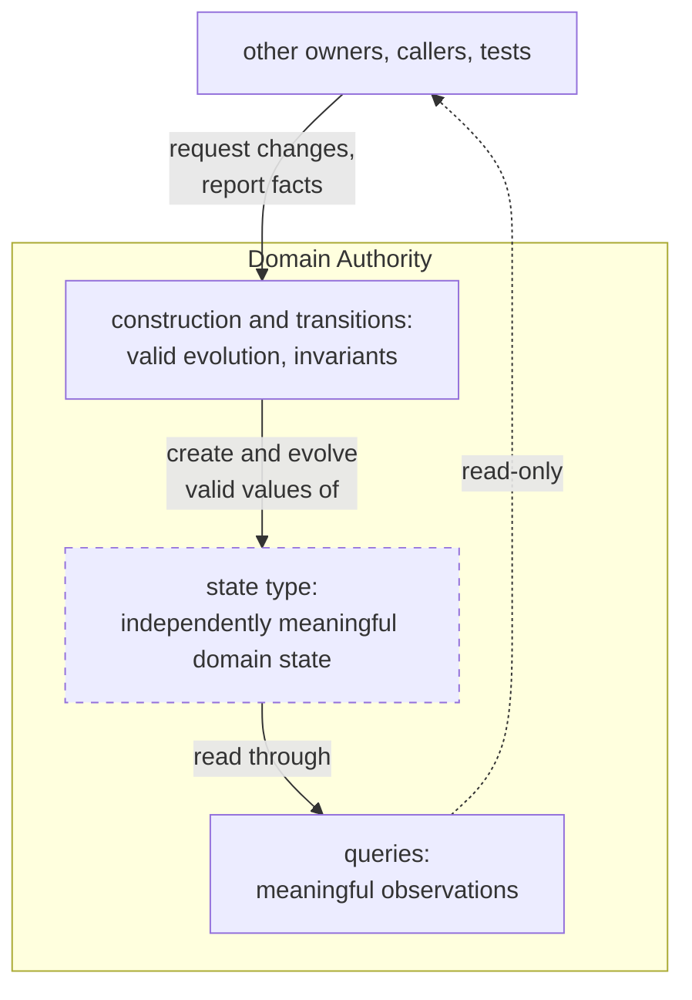

# Finding the Owners of Domain Meaning

**How Ownership Boundaries Emerge from the Domain**

The previous post argued that meaningful decisions need explicit, executable homes, and that even well-structured code does not necessarily provide such homes. Whether it does is up to us. Principles such as separation of concerns and single responsibility help us organize a system, but we must decide what belongs together and what stays apart. The same programming mechanisms that structure code around technical responsibilities can also draw ownership boundaries around domain meaning. The challenge, then, lies not in the mechanisms but in identifying what constitutes a single responsibility in the domain and which concerns should remain separate.

Orbital Orders gives us something concrete to examine. We have already met Order, Arena and Game as owners of meaningful state. So far, however, we have only introduced them, not shown why their ownership boundaries lie where they do. Why do the player's intention, the actual world and the game's progress need separate owners, even though all three are involved in completing an order? More generally, how do we recognize when the rules for how state may and may not evolve belong together under one owner?

## Owners of Domain State

Part of the answer is already familiar from this blog. A [Protecting State Module](mastering-state-in-modern-cpp-making-it-protected.md) groups state with the only functions allowed to evolve it: other code may hold the state, pass it on and request its transitions, but only the module defines how the state may change. The [Encapsulating State Module](mastering-state-in-modern-cpp-making-it-encapsulated.md) complements it by localizing who interprets a state. Such modules pay off only where the meaning of state, or the rules for how it may and may not evolve, need an owner. When that state is domain state and its evolution needs an owner, Executable Semantic Architecture (ESA) calls that owner a Domain Authority.

A **Domain Authority** owns the valid evolution of independently meaningful domain state. It establishes valid initial state, defines the transitions through which that state may change, and preserves the invariants that must hold across them. Other code may read what an Authority owns through its queries, and many places may request its transitions. Only the Authority defines what a valid change is.

Here is the picture in a visual nutshell:



Mechanically, nothing here is new. A Domain Authority can be built exactly like a Protecting State Module: a state value with a private representation, and a set of construction, transition and query functions that alone can create and evolve it. Together, those operations form the Authority's public contract.

What is new is the reason for drawing the ownership boundary. A Domain Authority is about state the domain itself cares about: domain state whose facts product, engineering and testing would discuss as part of the product, and whose evolution follows rules that have to stay coherent.

The guiding question therefore changes. Instead of asking which class holds some data, we ask: *who owns the valid evolution of this domain state?* Let us put that question to the order from the previous post, the one that completed with 20 points.

## The World and the Score

In that history, the snake collects two food items on its way to the destination and arrives, and the order's 20 points are credited. Let us take a closer look at two of the owners involved: Arena and Game.

**Arena** owns the world. Its domain state holds the board, the snakes, the food and each snake's executing order. That state means something to the product on its own: it is what happened on the board. It evolves step by step: orders activate, snakes move, collisions and collection are resolved, and orders complete. Within every step, the rules behind these changes, the rules for how the world may and may not evolve, have to stay coherent with one another. An order, for instance, completes only if its snake reaches the target and survives the step, so whether it completes depends on how that step's collisions turned out. Change how collisions are resolved, and what counts as a completion changes with it.

**Game** owns the game's progress. Its domain state holds the credited points, the points still unbanked for an executing order, the elapsed time and, once the game is over, who won. That state, too, means something on its own: it is how the game stands. Its rules for how that state may and may not evolve are of a different kind, and they have to stay coherent among themselves in the same way. Points collected during an order wait for its outcome; the game ends when its time is up or no snake is alive. Because a step is scored before the game may end, an order that completes on the very last step still counts: when a step is scored and when the game ends have to be decided together.

That is why the product has two owners here: two independently meaningful domain states, each with rules that have to fit together, but not with the other's. You can see this by changing one set of rules: the other stays as it is. A different ending condition or banking rule (Game) would leave movement and collisions (Arena) untouched. A different collision rule (Arena) would change what happens on the board, and so which orders complete, but not how completed orders turn into points (Game). The same holds for checking them: a tester checking whether a collision was resolved correctly looks at the world; one checking whether points were credited correctly looks at the score.

The split between the two owners is easiest to see at the order's last step. The snake reaches the target and survives, so the order completes. That is a fact about the world, and Arena establishes it. That the order's 20 points are now banked is a second change, to the score, and that one is Game's: Game receives the completion as a fact and reacts with a transition of its own state, turning the unbanked points into credited ones. What looks like one event is two, kept apart deliberately because they change different domain states.

## Game's Public Contract, Executed

The state and rules just described for Game are what its public contract makes executable. Only the functions of its [public contract](https://github.com/mahush/funkysnakes/blob/361d026d0de76fabdd3b996b1b33bf2a7dc3b7a2/semantic_artifacts/include/orbital/game_authority.hpp) can create or change Game's state, and the header groups them the way the picture above does:

```cpp
// Construction: establish a valid initial state from explicit setup
State startRound(RoundId round, const std::vector<PlayerId>& players);

// Transitions: evolve the state; return it with outputs it does not encode itself
std::tuple<State, std::optional<GameConcluded>> observeStep(State state,
                                                            GameTime now,
                                                            const std::vector<ActivationOutcome>& activations,
                                                            const ArenaEvents& events,
                                                            const std::set<PlayerId>& alive);
// ...

// Queries: read the state without evolving it
bool isRunning(const State& state);
View view(const State& state);
```

`observeStep` takes one step's facts from Arena and returns Game's new state, plus a `GameConcluded` intent when that step ends the game. The omitted transition serves a rule for a later post. What each event is worth, Game leaves to a stateless scoring rule, which we come back to at the end.

Because the contract takes Arena's facts as plain values, Game can be executed on its own. One of its [tests](https://github.com/mahush/funkysnakes/blob/361d026d0de76fabdd3b996b1b33bf2a7dc3b7a2/tests/test_orbital_game_authority.cpp#L193-L210):

```cpp
/// @brief The step due at the end of the game still counts, including a completion it brings
TEST(OrbitalGameAuthority, BanksCompletionOnFinalStepBeforeConclusion) {
  // Given: order F of A holds 20 unbanked points
  auto [state, first] = game_authority::observeStep(
      runningGame(),
      milliseconds{1000},
      {},
      {FoodCollected{PLAYER_A, Point{1, 1}, OrderId{1}}, FoodCollected{PLAYER_A, Point{2, 1}, OrderId{1}}},
      BOTH_ALIVE);

  // When: F completes on the step at two minutes
  auto [final_state, concluded] = game_authority::observeStep(
      state, std::chrono::minutes{2}, {}, {OrderEnded{OrderId{1}, EndReason::COMPLETED, std::nullopt}}, BOTH_ALIVE);

  // Then: A's 20 points count and A wins
  EXPECT_EQ(game_authority::view(final_state).players.at(PLAYER_A).credited, 20);
  EXPECT_EQ(concluded->result, (Result{PlayerId{PLAYER_A}}));
}
```

The test needs no Arena, no Order and no running clock. It writes down the facts Arena would report and reads the outcome through `view`. Checking the scattered decision from the previous post's opening might take assembling several classes and faking a clock; this rule needs nothing but its owner. The test expects the order's 20 points to count although the game ends on that very step. That is the coherence from the previous section, now executed: when a step is scored and when the game ends are decided in one transition of one owner.

## What Makes an Ownership Boundary Hold

The world and the score make the general answer visible. An ownership boundary holds where it separates domain states that each mean something on their own, and keeps together the rules that must stay coherent for one of them. Both halves matter, and the example showed each.

Drawn too broadly, an ownership boundary bundles rules that need not be coherent with each other. One owner for the world and the score would put the rules for collisions and the rules for the score in one place, although changing one leaves the other as it is. Drawn too narrowly, it separates rules that must stay coherent. A separate owner for the score, next to one for the game's end, would leave "score the step, then conclude" between the two, stated by neither.

A third distinction keeps an owner from reaching too far: establishing a fact is different from receiving it. Game receives Arena's completion and evolves its own state from it without becoming an owner of the world. Code that records, reports or reacts to a fact does not thereby own the evolution that established it.

The same reasoning places the third owner, Order. Its state, the player's instruction, means something on its own, and its rules stay coherent among themselves: a new submission replaces the pending order and waits for a deadline of its own. That state is neither the world nor the score, so it needs an owner of its own.

Authorities can also nest. Arena's state includes the snakes, and on every step Arena decides which snake transitions happen: in which direction a snake moves, whether it grows, whether a collision cuts it or kills it. What each of those transitions does to a snake's body, and that a dead snake stays dead, the snake itself defines. Arena owns the world, snakes included; each snake is a smaller Authority inside it, owning the rules for its own body and life. These are two scopes of ownership, not two competing owners.

Ownership boundaries come from the domain, but the domain does not dictate every detail of them. It answers the questions the criteria ask: which states mean something on their own, and which rules must stay coherent. Applying the criteria still takes judgment in two places. One is granularity: whether a smaller state inside another owner earns an owner of its own. The snake does here, because its rules are product rules with real alternatives: a snake longer than its head ignores a turn back into its own body, where the game could just as well let it bite itself. A team that never expects to discuss such rules could reasonably leave them inside Arena. The other is the public contract: which facts an owner reports, which queries it offers, and what a transition returns besides the new state, like Game's `GameConcluded` intent. Two teams can agree on the owners and still give them different contracts.

Readers who know Domain-Driven Design will recognize the idea: a DDD [Aggregate](https://www.martinfowler.com/bliki/DDD_Aggregate.html) also groups domain state whose invariants must hold together, with an Aggregate Root controlling access from outside. A Domain Authority shares that concern for coherent evolution, but its ownership boundary does not have to coincide with transaction or storage boundaries. Nor does it require object-oriented code: Game is a state value with free functions.

All of this answers the question we started with. Classes, modules and processes can draw an ownership boundary wherever we put them; they do not tell us where it belongs. The domain does, so ownership boundaries follow domain state. Arena and Game run in one process today. Whatever topology the game is eventually deployed on, whether it keeps them together or places them apart, they remain two owners, because their states mean different things and their rules need not be coherent with each other. Keeping them separate even makes more topologies easy to reach: two owners can share a component or be placed apart as they are, while placing parts of one combined owner apart would first mean separating them. Where code runs may follow the owners; it does not define them.

## What Changes When State Has an Owner

The previous post sketched what explicit homes change for review and for tracing defects. Authorities make that more precise, and most of the payoff follows from one property: each owner's rules have to fit together, but not with the rules of another owner.

For a change, the property bounds the review. A changed product rule has one narrow place to go: a new collision rule belongs to Arena, so reviewing it means checking that Arena's rules still fit together, for instance that an order still completes only if its snake survives the step. Its consequences reach Game as different facts, since other orders now complete. As long as Arena still reports its facts as its public contract declares, Game's rules need no second look; checking that contract is part of reviewing Arena. A product rule that needs both owners, for instance because one has to report a new fact to the other, splits into one change per owner, each reviewed against that owner's rules, plus the new fact that connects them. Whether the game as a whole still plays as intended is a question for the whole domain, which a later post takes up.

For a defect, the same property narrows the search. Game's transitions are deterministic and depend only on the facts Game receives, so if Game's view shows a wrong score, the defect lies either behind Game's public contract, including the scoring rule its transitions apply, or in the facts Game received. If we know those facts, one new Game test, fed with them from the start of the game, decides between the two. If it fails, the test stays as a regression test; if it passes, the search moves outside Game, to where those facts came from.

Tests and delegated work follow the same ownership boundaries. A test of a single Authority, like that one, documents and guards that Authority's product rules in the narrowest possible scope. A task handed to a colleague or an AI agent can name the one owner it is allowed to change, and its review then knows which rules to check.

This payoff has a price. Each owner adds a public contract that has to be designed and maintained. Behind that contract, each one must define a result for every input it can receive, including inputs the usual flow never produces; Game, for instance, defines that a step observed after the game has concluded changes nothing, and [a test](https://github.com/mahush/funkysnakes/blob/361d026d0de76fabdd3b996b1b33bf2a7dc3b7a2/tests/test_orbital_game_authority.cpp#L240) pins that down. Price and payoff both come per owner, so dividing more finely is a trade-off rather than a rule. A separate owner spares its rules a second look whenever a neighboring rule changes, even if they themselves never change; in return, it adds one more contract. Where to stop is the judgment from earlier in this post: separate what means something on its own, and keep together what must fit together.

A change, a review, a test, a defect search, a delegated task: each has a precise place to start, one Domain Authority, and that Authority's public contract marks where it may stop. What stays behind the contract stays local; what changes the contract reaches the owners that use it. That is what the abstraction adds: without it, the same rules would still exist, but nothing would mark where any of this starts or may stop.

## Meaning Without State

In this post we discussed meaning that lives in evolving state: the world, the score and the player's instruction, each with an owner for its valid evolution. Not every meaningful rule evolves state, though. Some only decide something from the facts at hand.

The score shows one. Game's transition evolves the score, but what collected food is worth, and that a completed order banks its points, comes from a stateless scoring rule that the transition applies. So far we counted that rule among Game's; Game applies it, but the rule itself is a decision of its own. The rule is clearly meaningful: with other values or another banking rule, it would be a different game. Yet it keeps no state, so our guiding question, who owns the valid evolution of this domain state, has no grip on it. In Orbital Orders, the rule already has a home of its own, which Game uses. Why give a rule a separate owner when it only ever takes effect through Game's score? That is the question of the next post.