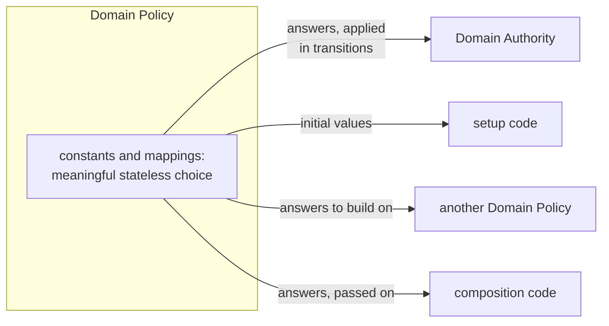

# When a Calculation Is a Product Decision

**Giving Stateless Domain Rules an Explicit Home**

The previous post established why the world and the score in Orbital Orders have different owners. Arena defines how the world evolves; Game defines how the game's score and progress evolve. Some of the rules Game applies, however, define no evolution. Food collected during an order is worth ten points, whatever the score currently is, and a reasonable alternative such as fifteen would make a different game. We called this stateless scoring rule "a decision of its own" and noted that Orbital Orders already gives it a home of its own, which Game uses.

Leaving the rule inside Game would have been the natural default. It has no evolution of its own to protect, and it matters only through the score it is applied to, which already has an owner. Keeping the two together puts everything about scoring in one place, and a separate owner does not come for free. Many well-structured codebases would make such a rule a private helper of the class that keeps the score, often for good reasons.

Yet applying a rule is not the same as owning it. Game applies the scoring rule, but it does not need to own it. When does a meaningful stateless choice deserve an owner of its own, rather than living inside the Authority that applies it?

## Deciding Without Acting

Let’s look at what the scoring rule does. Given that food was collected during an order, it answers that ten points are held for that order, and Game applies that answer to its score. The rule decides; Game acts. ESA calls the owner of such a rule a Domain Policy.

A **Domain Policy** owns a meaningful stateless choice of the domain: constants, such as what food is worth, or mappings from facts to answers, such as what an order's ending means for the points it holds. It keeps no domain state and evolves none. Whoever needs the choice asks the Policy and uses the answer: an Authority applies it in a transition, setup code takes initial values from it, another Policy builds its own answer on it, and the code that composes the domain's owners passes it on to the owner that acts on it.



Building a Domain Policy takes nothing new: constants and pure functions will do. Where an answer tells someone else what to do, such as holding ten points for an order, handing it over as a value instead of acting on it is the familiar idea behind the Command pattern. The new part is the guiding question, the counterpart of the previous post's: *who owns this meaningful stateless choice?* Where only setup code, composition or other Policies use the choice, the answer is plain: it keeps no state, so it needs no Authority, and a Policy owns it. It is less obvious when an Authority applies the choice to its own state, as Game applies the scoring rule, because keeping the choice inside the Authority then seems natural.

For that case the criterion is **independence**, the same one by which the previous post separated owners: if the choice need not agree with the Authority's rules for evolving its state, it belongs in a Domain Policy. A sign of this is that each can change without the other. The next section puts the scoring rule to that test.

## Untangling a Policy from an Authority

Start with the Authority. Game's state records the points each player has banked and the points still held for each executing order. Its rules decide how that record may change: held points stay with their order until the order ends, they are banked or dropped only once, and Game always applies what just happened before it checks whether the game is over. These rules must agree with one another. An order that completes just as time runs out counts only because of that sequence: were the end checked first, Game would end the order together with the game, and its points would be dropped instead of banked.

Now the Policy. Orbital Orders gives the scoring rule to **Scoring Policy**, and it works differently. It assigns worth to events: ten points for food collected during an order, held for that order. And it says what an order's ending means for those points: completion banks them, every other ending drops them. That includes an order still executing when time runs out, which ends with the game. Game establishes *that* the order ended; Scoring Policy decides *what* that means for its points. Each answer comes from the fact in front of it; there is nothing to remember. Game's transitions depend on the answers the contract allows, but not on which one Scoring Policy picks for a given fact: with other values, Game would hold, bank and drop points in just the same way.

Vary either side and this becomes visible. Make food during an order worth fifteen points, the alternative from the beginning, or let an order still executing when time runs out keep its points. Players would notice, but Game's rules would read exactly as before: points would still be held per order, banked or dropped once, and applied before the end is checked. Turn it around and change one of Game's rules, say the sequence in which it applies what just happened and checks for the end, and Scoring Policy's values and mapping are untouched.

That is why the rule lives in Scoring Policy rather than in Game. Game still defines how the score evolves and applies Scoring Policy's answers in its transitions, but which answers those are is not Game's to say.

## A Rule You Can Call

In code, the choices just described are what Scoring Policy's [public contract](https://github.com/mahush/funkysnakes/blob/361d026d0de76fabdd3b996b1b33bf2a7dc3b7a2/semantic_artifacts/include/orbital/scoring_policy.hpp) declares:

```cpp
constexpr int FOOD_POINTS = 10;  // During an order, held
// ...

struct Bank { PlayerId player; int points; };                // Counts at once
struct Hold { OrderId order; PlayerId player; int points; };  // Counts once its order completes
using PointEffect = std::variant<Bank, Hold>;

enum class Settlement {
  BANK,  // Added to the player's banked points
  DROP   // Dropped
};
// ...

std::vector<PointEffect> effectsOf(const ArenaEvent& event);
Settlement settlementOf(EndReason reason);
```

`effectsOf` takes an event Arena reports, such as a food collection, and returns its point effects. Each names a player and a number of points: a `Bank` adds them to the player's banked points at once, a `Hold` attaches them to an order until the order ends. `settlementOf` takes the reason an order ended and returns what happens to its held points: banked or dropped. Both forms from the definition are here: `FOOD_POINTS` is a constant, `settlementOf` a mapping. Nothing in this contract refers to a score. The Policy does not know how many points anyone has, and it has no way to change them.

With facts in and answers out, both as plain values, the rule runs without anything around it. Here is one of its [tests](https://github.com/mahush/funkysnakes/blob/361d026d0de76fabdd3b996b1b33bf2a7dc3b7a2/tests/test_orbital_scoring_policy.cpp#L81-L88):

```cpp
/// @brief Held points count once the order actually completes
TEST(OrbitalScoringPolicy, BanksCompletedOrder) {
  // When: the settlement of a completed order is decided
  Settlement settlement = scoring_policy::settlementOf(EndReason::COMPLETED);

  // Then: its points are banked
  EXPECT_EQ(settlement, Settlement::BANK);
}
```

No Game is constructed and no score exists, and the assertion reads like the rule itself. Whether Game applies such answers correctly is left to Game's own tests.

## Recognizing a Domain Policy

The scoring rule passed the independence test, but it came to that test already *meaningful* and *stateless*; the definition built both in. In other code neither can be taken for granted, and recognizing a Domain Policy means checking them too.

Start with meaning. Plenty of stateless code is independent of an Authority's rules without being a choice the product cares about. Reading a snake's head off its body is one example: however it is written, no player would notice. This is where a calculation and a product decision part ways: a calculation is a product decision when a reasonable alternative would make the product behave differently. The form of the code is no guide. Writing [`settlementOf`](https://github.com/mahush/funkysnakes/blob/361d026d0de76fabdd3b996b1b33bf2a7dc3b7a2/semantic_artifacts/src/orbital/scoring_policy.cpp#L36-L46) as a lookup table instead of a `switch` would change nothing for players, yet moving its single label `case EndReason::ROUND_ENDED:` from the cases that drop to the case that banks would let an order still executing when time runs out keep its points.

Then state. Scoring Policy's contract refers to no score. Suppose it did: given the score and an event, the Policy returns the next score. Then it no longer only decides what food is worth; it defines how the score evolves, and that makes it an Authority, a second one for the score Game already owns. Game's rules from above, which must agree, would be split between two owners, and neither could keep them consistent alone. Defining how domain state may evolve is Authority work, however the code is labelled; holding that state or calling an Authority's transitions is not.

To recognize a Domain Policy, then, ask three things of a calculation. Would a reasonable alternative change the product? If not, it stays a calculation. Does it define how domain state evolves? If so, it is Authority work. Must it agree with the rules of the state it is applied to? If so, it belongs to that state's Authority. A product decision that defines no evolution and need not agree is a Domain Policy, whether an Authority, setup code or another Policy asks it.

The questions leave one judgment open: how finely to divide. Scoring Policy keeps the worth of events and endings together, because the product discusses them together as scoring. A team could split them; each split adds a contract, so it pays off when the parts change for different reasons or are decided by different people.

Domain-Driven Design has a close relative. Eric Evans brings the Strategy pattern into the domain model as *Strategy (a.k.a. Policy)* (*Domain-Driven Design*, 2003, chapter 12): the varying part of a process is factored out, and a rule is kept apart from the behavior it governs. Evans stresses that in the domain the pattern's value lies in making a process or policy concept explicit, not only in swapping implementations, which brings it close to a Policy and the Authority that applies it. What earns the separation differs, though. Strategy is still built around variants of a process; a Domain Policy is earned by ownership: a choice the product could make differently, even if only one version ever exists. That is why a single constant can be a Domain Policy without calling for a Strategy.

## What the Separation Buys

Scoring Policy and Game meet only at the Policy's public contract, and that contract decides how far a change travels.

A changed value or mapping stays behind it. Both changes from earlier, fifteen points for food during an order and the moved `ROUND_ENDED` label, edit Scoring Policy alone, together with the expectations in its focused tests. Game's code stays as it is. Some of Game's tests would expect new numbers, since they run with the real Policy, but what they check does not change.

A changed contract travels further. Suppose a third outcome joined banking and dropping: an order cut short keeps half of its held points. Scoring Policy can decide when that applies, but only Game can say what keeping half means for its score, so the change reaches Game: [`settleOrder`](https://github.com/mahush/funkysnakes/blob/361d026d0de76fabdd3b996b1b33bf2a7dc3b7a2/semantic_artifacts/src/orbital/game_authority.cpp#L16-L31), where Game applies the outcome, has to learn the new one. The previous post observed the same for Authorities: what changes behind a contract stays with its owner; what changes the contract reaches everyone who uses it.

Review follows that line. The first post imagined a small pull request that changed whether points collected during an order count, and a reviewer left to reconstruct the rule from the code around it. In Orbital Orders, that pull request touches Scoring Policy, and its review turns on one question: is this how the game should score? As long as the Policy still answers within its contract, Game's rules need no second look; checking that contract is part of reviewing the Policy.

Diagnosis narrows as well. The previous post placed a wrong score, with correct facts going in, somewhere behind Game's public contract, the scoring rule included. That region now splits. One Policy test with the fact in question shows whether Scoring Policy gave the intended answer. If it did not, the test stays as a regression test; if it did, the search moves on to Game.

None of this is free. The Policy is one more contract whose shape has to be chosen and then kept stable for everyone who relies on it, and it has to answer every input it accepts: `settlementOf` returns an outcome for every end reason, including the one that only arises when time runs out. A localized rule also leaves questions open. Whether a game with fifteen points per food still plays well is a question about the whole game, and no Policy test answers it. Spent on a calculation without meaningful alternatives, a Policy's contract buys nothing. Spent on a product decision, it gives the decision a place of its own, where it can be discussed, changed and checked apart from the code that carries it out.

## From Separate Owners to One Domain

Order, Arena, Game and Scoring Policy now each have an owner, and each runs and is checked on its own. A game of Orbital Orders, though, is none of them; it is their interaction. Since each owner is executable, so is their combination. But something has to route submissions, time and facts between them, and if that something decides anything, meaning is back in code nobody owns. When is the combination a complete, executable reference of the domain, rather than the owners plus whatever the wiring supplies? That is the question of the next post.